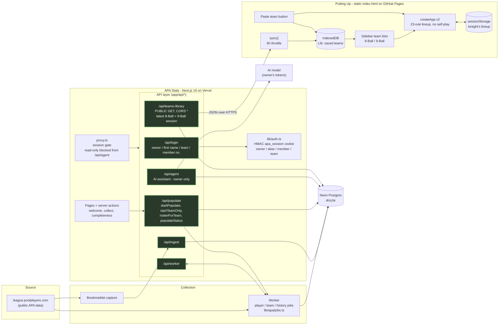

# Putting Up

A live, phone-friendly tool for APA team captains to put up players under the **23 rule** — each team's 5 players' skill levels can't total more than 23.

[LIVE](https://mathcodes.github.io/putting-up/)

## Layout
The page has two independent copies of the tool, each with its own rosters, lineup and saved data:
- **8-Ball** on top (SL 2–7)
- **9-Ball** below (SL 1–9)

Each section has a ball banner and its own **📋 Paste 8-Ball team here** / **📋 Paste 9-Ball team here** button, with a one-line note: team not listed? paste its info here. If you paste a 9-ball matchup into the 8-ball section (or the other way round), it warns you and offers to load it into the right section.

A **🔗 Links** section at the bottom collects league bylaws, APA/BCA rules, instruction (Dr. Dave) and community resources.

## What it does
- Two team rosters (name + skill level), up to 8 players each.
- 5 match slots (configurable); tap a player to put them up in the highlighted slot.
- Running total vs. the cap for each team, room left, slots left, and **max SL allowed next**.
- Players already played that night are greyed out and removed from the pool.
- Players who **can't** play are redded out: a player is ineligible if their SL plus the cheapest possible fill for the remaining slots would push the team over the cap (so it warns you *before* you paint yourself into a corner).
- "Not here" toggle (💤) for absent players; forfeit warning if you run short.
- Alternating "who puts up first" indicator per match (⇄ to swap).
- Cap is editable per section.
- The app starts with no teams assigned. "New night" clears that section (8-Ball or 9-Ball): teams, lineup and match info. Saved teams stay in the Teams list. Tonight's lineup is kept for the browser tab (a reload keeps it, a new visit starts empty); saved teams persist in IndexedDB.

## Saved teams
A **Teams** sidebar (a 👥 Teams drawer on phones) keeps every team you've loaded, split into an **8-Ball** list and a **9-Ball** list. A team shows up under whichever format's stats you loaded, and under both once you've loaded both.
- Tap a team to fill the next empty roster (Home first, then Away); **H** / **A** pick a side; ✕ removes it from the list. A team can never be loaded on both sides: it is marked "playing as Home/Away" and the other side is blocked. Teams whose roster APA Stats hasn't captured yet are still listed ("no roster yet"); loading one sets the team name and you add players or paste the matchup.
- Teams are saved in the browser's IndexedDB (no files, no server) the moment you load a matchup or a single team.
- **Sync from APA Stats** (also runs on load, at most every 6 hours) adds the current session's teams, rosters and skill levels from the APA Stats site's read-only `/api/teams-library`. A roster you pasted yourself is never overwritten by a sync, and teams you remove stay removed. If the site can't be reached, the saved teams still work.

## Paste a matchup
Tap **📋 Paste matchup**, then paste the matchup page from poolplayers.com (from the date down through the last away player). It picks up:
- Home and away team names, team numbers (e.g. #93704) and division team numbers (04)
- Every player's name, member #, skill level, and season stats (W/P, win %, PPM, PA)
- Match date, time, venue, div reps, scored/scoresheet status
- Format (9-ball vs 8-ball), detected from skill levels and PPM

You get a preview before it loads. A single team's roster table also works; you choose Home or Away.

## Run
No build step — it's a single static file.

```bash
open index.html          # or: npx serve .
```

Live on GitHub Pages: **https://mathcodes.github.io/putting-up/**

Every push to `main` redeploys automatically via `.github/workflows/pages.yml`. If the first run fails at *configure-pages*, go to **Settings → Pages → Build and deployment → Source: GitHub Actions**, then re-run the workflow.

## Architecture

Putting Up is a static page; its only backend is the public `/api/teams-library` route of [APA Stats](https://github.com/mathcodes/apa-stats). API components are highlighted in green.



Download: [PDF](docs/architecture.pdf) · [PNG](docs/architecture.png) · source: `docs/architecture.mmd`

## One-click add from APA (bookmarklet)

APA's team pages need a sign-in, so Putting Up can't fetch them itself. The **Send to Putting Up** bookmarklet does it from your own signed-in browser:

1. Open the **Teams** list and expand **One-click add from APA**. Drag **Send to Putting Up** to your bookmarks bar (on a phone, tap **Copy bookmarklet** and save it as a bookmark's address).
2. Sign in at league.poolplayers.com and open a team page, or tonight's matchup.
3. Tap the bookmark. Putting Up opens, reads the roster with the same parser as the paste box, and saves the team(s) to your Teams list.

The page text travels in the link to this page only; nothing is sent to any server.
